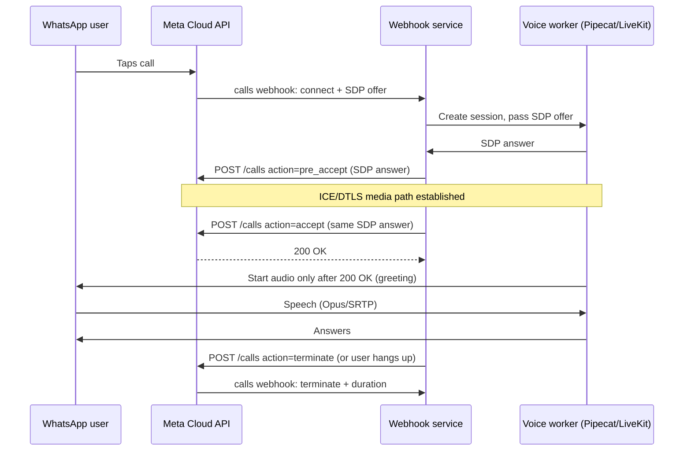
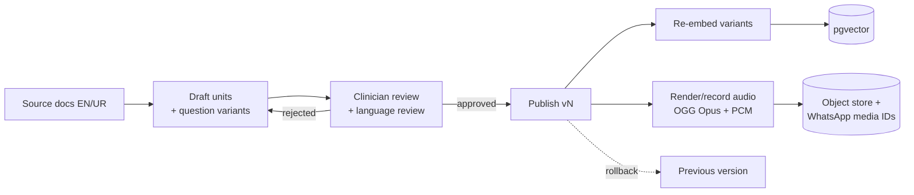

# POC Technical Analysis — HPV Vaccine Conversational Bot (Meta / WhatsApp)

**As of:** 25 Sep 2026 · **Scope:** English + Urdu (script and Roman), text · voice notes · live calls · voicemail, public users + frontline health workers
**Recommended architecture:** Option C — WhatsApp Cloud API + Calling API → cascaded voice pipeline (Pipecat/LiveKit) → retrieval-only core over clinician-signed answer units.

This document covers the engineering detail behind that recommendation: targets, latency, language handling, evaluation, data model, Meta integration, guardrails, content pipeline, infra, observability, cost, risks, de-risking spikes and extensibility. Figures marked *(est.)* are my estimates from listed vendor prices, not quotes.

---

## 1. Requirements and non-functional targets

These are proposed POC targets. Every later design choice should trace back to one of them.

| Requirement | POC target | Rationale |
| --- | --- | --- |
| Voice call turn latency (end of user speech → first bot audio) | p50 ≤ 1.2 s, p95 ≤ 1.8 s | Pipecat's co-creator suggests 800 ms median as the production goal but 1,500 ms as acceptable for a POC ([MarkTechPost](https://www.marktechpost.com/2026/08/30/lowest-latency-inference-apis-for-voice-and-realtime-agents-a-time-to-first-token-ttft-first-benchmark/)); 1,200–1,500 ms is a cited SLO range for clinical/tool-heavy turns ([FutureAGI](https://futureagi.com/blog/how-to-measure-voice-ai-latency-2026/)) |
| Call connect time (call rings → bot greeting) | ≤ 2 s | Meta allows ~30–60 s to accept, but pre-accept avoids clipped audio ([Meta](https://developers.facebook.com/documentation/business-messaging/whatsapp/calling/user-initiated-calls)) |
| Text reply latency | p95 ≤ 3 s | Text users tolerate delay; typing indicator covers it |
| Voice-note reply latency (note received → text + audio reply sent) | p95 ≤ 10 s | Async channel; includes media download, batch STT, TTS, upload |
| Correct answer retrieved (top-1) | ≥ 85% overall, ≥ 80% on Roman Urdu | Below this the bot creates more confusion than it resolves |
| Escalation recall (danger phrases → escalation) | ≥ 98% | Safety-critical; false positives are acceptable |
| Out-of-scope deflection | ≥ 95% | Also Meta 2026 AI-policy compliance |
| Concurrency (pilot) | 20 simultaneous calls, 10 msg/s inbound | Pilot scale; well under Meta's 80 msg/s default per number |
| Availability | 99% during pilot hours | POC; no multi-region |
| Cost ceiling | ≤ $0.10 per text conversation, ≤ $0.10 per call minute *(est.)* | See §11 |

---

## 2. Voice latency budget

The call path is WebRTC end to end: WhatsApp → Meta → our media server (Pipecat SmallWebRTC or LiveKit). There is no PSTN hop, which removes a common latency source.

| Stage | Budget (target) | Notes |
| --- | --- | --- |
| Network + media (user ↔ Meta ↔ our server, both directions) | 100–200 ms | Host near Pakistan (see §9); Meta's media edge location is not published, so measure it (Spike 2) |
| VAD / end-of-turn detection | 200–400 ms | Silero VAD default; endpointing typically 150–400+ ms ([Deepgram](https://deepgram.com/learn/voice-agent-architecture-stt-llm-tts-pipeline-design)). Urdu speakers pause mid-sentence; don't go below ~300 ms |
| STT finalization (streaming) | 150–300 ms | ElevenLabs Scribe v2 Realtime claims ~150 ms partials ([ElevenLabs](https://elevenlabs.io/speech-to-text)); Urdu accuracy must be verified |
| Language/role detect + retrieval + confidence | 50–150 ms | Embedding call + pgvector ANN on a few hundred units is fast; no LLM in the default path |
| Optional LLM (select/rephrase) | 0 or 300–700 ms | Skip for high-confidence hits; only for ambiguous top-k |
| TTS time-to-first-audio | 100–400 ms | Pre-recorded audio for top answers = ~0 ms; streaming TTS otherwise |
| **Total (no LLM)** | **~0.6–1.5 s** | Meets the POC target |
| **Total (with LLM)** | **~0.9–2.2 s** | Only on ambiguous turns |

Design consequences:
- **Retrieval-only by default** is also the latency win. The LLM is the stage that usually dominates ([Hamming](https://hamming.ai/resources/voice-ai-latency-whats-fast-whats-slow-how-to-fix-it)).
- **Pre-render audio** for every answer unit (recorded or TTS-generated offline, cached as OGG/Opus and PCM). Live TTS only for dynamic text.
- **Stream everything:** partial STT, early retrieval on stable partials, streaming TTS.
- **Fillers:** play a short "جی، ایک لمحہ" ("yes, one moment") clip if retrieval + TTS exceeds ~700 ms.
- **Co-locate** voice worker, STT/TTS endpoints and vector DB in one region. Cross-region hops add 60–150 ms per turn ([FutureAGI](https://futureagi.com/blog/sub-500ms-voice-ai-guide-2026/)).

---

## 3. Language handling (hardest technical problem)

### 3.1 Input variants to support

| Variant | Example | Source |
| --- | --- | --- |
| English | "Is the HPV vaccine safe?" | Text |
| Urdu script | "کیا ایچ پی وی ویکسین محفوظ ہے؟" | Text, STT output |
| Roman Urdu (inconsistent spelling) | "kya hpv vaccine mehfooz hai" / "mahfuz" / "teeka" / "tika" / "vacsin" | Text (most common in practice) |
| Code-switched | "HPV ka vaccine safe hai kya meri beti ke liye?" | Text and speech |

### 3.2 Pipeline

1. **Script/language ID.** Unicode range check separates Urdu script (Arabic block) from Latin. For Latin text, a lightweight classifier (fastText-style or a small fine-tuned model) separates English from Roman Urdu. Store the detected variant per user as a reply-language preference.
2. **Normalization.** Lowercase, strip diacritics/elongations ("plzzz"), map common Roman Urdu variants via a lexicon (vaccine/vacsin/waxin → ویکسین). A domain lexicon of ~200–500 terms covers most vaccine vocabulary.
3. **Transliteration (Roman → Urdu script)** for (a) retrieval robustness and (b) TTS input. Transformer transliteration (m2m100 fine-tuned) reaches Char-BLEU ~97 for Roman-Urdu→Urdu ([arXiv 2503.21530](https://arxiv.org/html/2503.21530v2)); a lexicon + rules approach is the cheaper POC fallback (e.g. [raabta](https://github.com/HasnatKhan010/raabta) uses a 12k-word lexicon + query expansion for cross-script retrieval).
4. **Multi-variant query expansion.** Embed the raw query and its transliteration; take the best score across both.
5. **Reply language.** Reply in the user's variant. For Roman Urdu users, send stored Roman Urdu text of the unit (authored, not machine-transliterated) and Urdu-script-based audio.

### 3.3 Embeddings

- **BGE-M3** is the default: 100+ languages, strong multilingual/cross-lingual retrieval, supports dense + sparse + multi-vector retrieval in one model ([paper](https://arxiv.org/html/2402.03216v3)). Hybrid dense + sparse helps with exact terms like "HPV", "Cecolin".
- **Unverified for Roman Urdu.** No published benchmark found for BGE-M3 on Roman Urdu → Urdu-script matching. Independent Indic benchmarks show no single model wins all tasks ([arXiv 2601.10205](https://arxiv.org/pdf/2601.10205)). Spike 3 compares BGE-M3 vs multilingual-E5-large on our eval set.
- **Index each unit several times:** canonical EN question, UR question, Roman UR question, plus 5–15 paraphrases per unit ("question variants"). Match against variants, return the unit.
- Optional **cross-encoder reranker** (bge-reranker-v2-m3) on top-10 if top-1 accuracy is short of target.

### 3.4 TTS input constraint

Urdu TTS vendors expect Urdu script. Uplift's LiveKit plugin explicitly states its TTS should only receive Urdu script, not Roman Urdu ([PyPI](https://pypi.org/project/livekit-plugins-uplift)). Store Urdu-script text for every unit. Never TTS a Roman Urdu string.

---

## 4. Evaluation methodology

### 4.1 Datasets to build

| Set | Size (POC) | Composition |
| --- | --- | --- |
| Retrieval eval | 300–500 questions | Per unit: EN, UR script, Roman UR, code-switched; include typos; 20% myth/rumour questions; 10% out-of-scope; 5% danger phrases |
| Voice-note audio | 100–200 real recordings | Recorded on WhatsApp by staff/volunteers across genders, ages, accents (Punjabi-, Sindhi-, Pashto-accented Urdu), noisy backgrounds; exported as the OGG/Opus WhatsApp produces |
| Live-call audio | 50 calls | Scripted + free-form, via the WhatsApp test number |
| Conversation scripts | 30–50 multi-turn | Follow-ups ("aur side effects?"), topic switches, persona switch (parent vs LHW) |

### 4.2 Metrics

| Component | Metrics | Pass bar (POC) |
| --- | --- | --- |
| Retrieval | Top-1, top-3 accuracy, MRR; per variant; confusion matrix for near-duplicate units | See §1 |
| Confidence threshold | Precision/recall of "answer vs don't know" across thresholds; pick threshold at ≥ 95% precision | Wrong answers < 5% of answered turns |
| STT | WER and CER (CER matters more for Urdu script), keyword recall on a clinical term list (HPV, Cecolin, AEFI, ویکسین, بانجھ پن…), hallucination rate on silence/noise | Keyword recall ≥ 90% |
| TTS | Pronunciation error rate on medical terms; MOS from 5+ native listeners | MOS ≥ 3.8 |
| End-to-end | Task success on scripted conversations, latency percentiles, escalation recall | See §1 |

### 4.3 STT candidates and what to test

| Candidate | Why | Notes |
| --- | --- | --- |
| ElevenLabs Scribe v2 / v2 Realtime | 90+ languages, keyterm prompting (batch up to 1,000 terms, realtime up to 50), code-switching | $0.22/h batch, $0.39/h realtime, +$0.05/h keyterms ([pricing](https://elevenlabs.io/pricing/api), [docs](https://elevenlabs.io/docs/overview/capabilities/speech-to-text)) |
| Speechmatics | Urdu supported in batch and real-time, custom dictionary, on-prem option | Starts ~$0.24/h ([Speechmatics](https://www.speechmatics.com/speech-to-text)); enterprise pricing for real-time |
| Uplift AI STT | Pakistan-focused Urdu specialist | Pricing not public; request quote |
| Meta Omnilingual ASR / SeamlessM4T v2 (self-host) | Open, Urdu covered; Seamless was best on Urdu ASR after fine-tuning in one benchmark ([arXiv 2409.11252](https://arxiv.org/pdf/2409.11252)) | GPU hosting; check licenses |

Use the existing clinical Urdu STT workbook methodology (hallucination, code-switching, lexical biasing, dialect variance) and add **WhatsApp-codec audio** as a new condition: calls and voice notes are Opus-compressed, and results on clean audio will overstate accuracy.

---

## 5. Data model

### 5.1 Answer unit

```yaml
answer_unit:
  id: hpv.safety.fertility.001
  vaccine: hpv                  # dimension for multi-vaccine
  intent: fertility_myth
  audience: [public, hcw]       # hcw-only units allowed
  severity: normal              # normal | escalate | emergency
  text:
    en: "..."
    ur: "..."                   # Urdu script (TTS source)
    ur_roman: "..."             # authored, not machine-transliterated
  audio:
    ur: s3://units/hpv.safety.fertility.001/ur.ogg   # recorded or pre-rendered
    en: s3://.../en.ogg
  question_variants:            # indexed for retrieval
    - {lang: ur_roman, text: "kya is se baanjh pan hota hai"}
    - {lang: ur, text: "..."}
  related_units: [hpv.safety.side_effects.001]
  sources: ["FDI HPV FAQ 2025", "WHO position paper"]
  review:
    reviewer_id: dr_xxx
    approved_at: 2026-10-01
    valid_until: 2027-04-01     # forces re-review
  version: 3
  status: published             # draft | in_review | published | retired
```

### 5.2 Other entities

| Entity | Key fields | Notes |
| --- | --- | --- |
| user | bsuid / wa_id hash, role (public/hcw), preferred language variant, hcw_verified_at, consent flags | Meta now sends **business-scoped user IDs (BSUID)** and may omit the phone number if the user adopted a username ([Meta](https://developers.facebook.com/documentation/business-messaging/whatsapp/calling/user-initiated-calls)). Key users on BSUID, not phone |
| session | user, channel (text/voice_note/call), started_at, last_unit_ids, open 24h window expiry | Carries context text ↔ call |
| turn | session, input (text or transcript ref), detected variant, top-k units + scores, decision (answer/clarify/deflect/escalate), unit served, latencies per stage | Audit + eval source |
| escalation | turn, reason, routed_to, acknowledged_at, resolved_at | Needs SLA tracking |
| content_version | unit_id, version, diff, reviewer | Rollback |

### 5.3 Conversation state

- Keep the last 1–3 served units per session. Follow-ups like "aur side effects?" re-rank with a boost to `related_units` of the previous answer.
- A call placed from a chat thread should pick up that chat's session (same BSUID), so the voice agent can say "about your question on side effects…".
- Session state in Redis (TTL 24 h, aligned to the customer-service window); durable log in Postgres.

---

## 6. Meta integration specifics

### 6.1 Webhooks (messages + calls)

| Concern | Detail | Implementation |
| --- | --- | --- |
| Authenticity | Verify `X-Hub-Signature-256` = HMAC-SHA256(app secret, raw body) before parsing ([Hookdeck](https://hookdeck.com/webhooks/platforms/guide-to-whatsapp-webhooks-features-and-best-practices)) | Constant-time compare on the raw body |
| Response time | Respond 200 fast (reported ~10 s requirement) | Enqueue and ack immediately; process async |
| Retries / duplicates | Undelivered webhooks retried up to 7 days (1 h with No Storage) ([Meta](https://developers.facebook.com/documentation/business-messaging/whatsapp/no-storage/)) | Idempotency on message `id` / call `id` |
| Ordering | Events can arrive out of order | Order by timestamp per session; ignore stale statuses |
| Status webhooks | Up to 3 per outbound message (sent/delivered/read) | Separate queue; don't block the reply path |

### 6.2 Inbound voice notes

- Incoming media URL is valid for **5 minutes**; media IDs from webhooks expire after 7 days ([Meta](https://developers.facebook.com/documentation/business-messaging/whatsapp/business-phone-numbers/media/)). Download immediately in the worker.
- Format: OGG/Opus. Most STT APIs accept it; otherwise transcode with ffmpeg to 16 kHz mono PCM.

### 6.3 Outbound audio replies (voice-note style)

- Send `.ogg` encoded with **Opus** and `"voice": true`; other formats arrive as a generic audio file ([Meta](https://developers.facebook.com/documentation/business-messaging/whatsapp/messages/audio-messages)).
- The play icon appears only for files ≤ **512 KB** ([Meta](https://developers.facebook.com/documentation/business-messaging/whatsapp/messages/audio-messages)). Mono Opus at 20 kbps fits ~210 s in 512 KB, which is enough for any answer unit.
- Upload once, reuse the media ID (upload persists 30 days); re-upload on a schedule or on miss.
- Voice messages now emit a "played" status webhook on first play (from 17 Mar 2026). This is a useful engagement metric.

### 6.4 Throughput and limits

- Default 80 msg/s per number, upgradable to 1,000; error 130429 on excess ([Hookdeck](https://hookdeck.com/webhooks/platforms/guide-to-whatsapp-webhooks-features-and-best-practices)). Not a POC constraint.
- A per-user pair rate limit also exists. Sending text + audio back-to-back to one user must be tested (Spike 4).
- Production calling requires a messaging limit of ≥ 2,000 unique recipients/day; test numbers are exempt ([Meta](https://developers.facebook.com/documentation/business-messaging/whatsapp/calling)).

### 6.5 Calling flow (user-initiated)



Key rules from Meta's docs ([user-initiated calls](https://developers.facebook.com/documentation/business-messaging/whatsapp/calling/user-initiated-calls)):
- **Pre-accept is recommended.** It sets up media before the call connects, cutting connect time and avoiding clipped audio. The accept SDP must match the pre-accept SDP.
- **Start sending media only after the accept returns 200 OK.** Too early loses the first words; too late plays silence.
- **~30–60 s window** to accept after the connect webhook, else the user sees "Not Answered".
- **Call terminate** must be sent via API even if RTCP BYE is seen, for accurate billing.
- **DTMF** is supported (RFC 4733, 8000 clock rate) but there is **no DTMF webhook**; digits arrive in the RTP stream. Useful as an IVR fallback ("press 1 for Urdu") if speech recognition fails.
- Only primary/companion **phones** can call (no web/desktop clients).
- Default signalling is Graph API + webhooks with WebRTC (ICE + DTLS + SRTP), Opus; SIP is optional ([Meta](https://developers.facebook.com/documentation/business-messaging/whatsapp/calling)). Pipecat's `WhatsAppTransport` implements this flow ([Pipecat](https://docs.pipecat.ai/api-reference/server/services/transport/whatsapp)).
- **TURN:** our media server must have a publicly reachable address or a TURN relay. Budget a TURN server (coturn) in the POC.
- Use `biz_opaque_callback_data` on accept to carry our session ID into the terminate webhook.

### 6.6 Templates

Needed only for business-initiated messages: callback permission (`VOICE_CALL_REQUEST`), HCW reminders. Categories determine price. Draft and submit early; approval takes time.

---

## 7. Guardrail engineering

| Guard | Implementation | Test |
| --- | --- | --- |
| Scope gate (HPV/vaccines only) | Retrieval confidence below threshold + a small intent classifier (vaccine / greeting / out-of-scope / abuse). Out-of-scope → fixed deflection unit | ≥ 95% on out-of-scope set; required for Meta's general-purpose AI ban ([Turn.io](https://learn.turn.io/l/en/article/khmn56xu3a-whats-app-s-2026-ai-policy-explained)) |
| Danger-phrase detection | Lexicon in EN, Urdu script and Roman Urdu variants (fainting, seizure, breathing difficulty, swelling, rash after dose…) + embedding match against an "emergency" unit cluster. Runs **before** retrieval | Recall ≥ 98% on danger set, including misspellings |
| Grounding | Default path sends the unit verbatim. If an LLM rephrases, a check verifies the output only contains claims from the unit (string/NLI check); on fail, send the unit verbatim | 0 unsupported claims in eval |
| Prompt injection | No LLM in default path. If used: user text only as data, strict output schema (unit_id selection), no tools | Red-team set of 50 injection attempts |
| Minors / PII | Don't request names, ages, locations beyond district; redact phone numbers/names in logs | Log audit |
| Abuse / spam | Rate limit per user; ignore floods; block list | Load test |

---

## 8. Content pipeline



- **Authoring tool for POC:** a Google Sheet or Airtable with one row per unit and per variant, synced to Postgres by a script. A full CMS isn't needed yet.
- **Validation on publish:** required fields for all languages, audio ≤ 512 KB, no Roman Urdu in the TTS field, reviewer + valid_until set.
- **Gap mining:** weekly job clusters low-confidence and "don't know" queries so reviewers can add units.
- **Rollback:** a unit version pointer. Retiring a unit removes its variants from the index immediately.

---

## 9. Infrastructure and operations

### 9.1 Hosting region

- Candidate regions: **AWS Mumbai (ap-south-1)** or **Middle East UAE (me-central-1)**. They are ~23 ms apart ([AWS](https://aws.amazon.com/blogs/aws/now-open-aws-region-in-the-united-arab-emirates-uae/)) and both close to Pakistan; AWS support also points Pakistani audiences to Mumbai ([AWS re:Post](https://repost.aws/questions/QUYZZJ0zUXQo-HMadwC9pzhw/hosting-location-near-to-pakistan)).
- The deciding factor is where STT/TTS vendors' endpoints are and where Meta's media edge is. Measure both in Spike 2 and co-locate.
- Avoid US hosting for the voice path. US↔Asia adds 150–250 ms ([Hamming](https://hamming.ai/resources/voice-ai-latency-whats-fast-whats-slow-how-to-fix-it)).

### 9.2 Components

| Component | POC choice | Scaling note |
| --- | --- | --- |
| Webhook service | FastAPI behind a load balancer, stateless | Horizontal |
| Queue | Redis Streams or SQS | Separates ack from processing |
| Text/voice-note workers | Python workers | Horizontal |
| Voice workers | Pipecat (or LiveKit Agents) per call, 1 process per ~N calls | Measure calls per vCPU; STT/TTS via API means no GPU |
| TURN | coturn | Public IP, UDP open |
| DB | Postgres + pgvector | A few thousand vectors; single instance fine |
| Cache/session | Redis | TTL 24 h |
| Object store | S3 | Audio assets, raw voice notes (short retention) |
| GPU | Only if self-hosting Omnilingual ASR / Seamless | Avoid for POC unless vendor Urdu STT fails |

### 9.3 Data, privacy and security

- **Pakistan law:** no data protection law is enacted as of May 2026. PECA 2016 (amended 2025) is the main statute ([Recording Law](https://www.recordinglaw.com/world-laws/world-data-privacy-laws/pakistan-data-privacy-laws/)). The draft PDP Bill would keep "critical personal data" in Pakistan and possibly localize parts of sensitive data ([Chambers](https://practiceguides.chambers.com/practice-guides/data-protection-privacy-2026/pakistan)). Design so storage location is configurable and PII minimal.
- **Meta side:** Cloud API stores message data in the US by default. Local Storage exists for selected countries (APAC list includes India, Singapore, Indonesia, South Korea, Japan, Australia; Pakistan not listed) ([360dialog](https://docs.360dialog.com/docs/waba-basics/architecture-and-security)).
- **Vendors:** prefer zero-retention modes (ElevenLabs offers zero retention and data residency options ([ElevenLabs](https://elevenlabs.io/speech-to-text-api))). Don't opt into Speechmatics' discount programme that allows training on your audio ([Speechmatics](https://www.speechmatics.com/pricing)).
- **Retention:** raw voice-note audio ≤ 30 days (for STT eval), transcripts pseudonymized, call audio not recorded by default.
- **Secrets:** system-user token in a secrets manager; rotate. Encryption at rest on DB and S3.

### 9.4 Frontline worker verification

| Option | Effort | Strength | POC pick |
| --- | --- | --- | --- |
| Allowlist of LHW phone numbers / BSUIDs from the program | Low | Strong if list is maintained | **Yes** |
| Invite code sent by supervisor | Low | Medium (codes leak) | Fallback |
| OTP to registered number | Medium | Adds nothing over allowlist on WhatsApp | No |

---

## 10. Observability

- **Per-turn trace:** channel, input (text / transcript + audio ref), detected variant, STT confidence, top-k units + scores, decision, unit served, and latency per stage (VAD, STT, retrieval, TTS, network). Use OpenTelemetry / OpenInference spans ([FutureAGI](https://futureagi.com/blog/how-to-measure-voice-ai-latency-2026/)).
- **Dashboards:** p50/p95 latency by stage and channel; answer / clarify / deflect / escalate mix; low-confidence rate by language variant; top unanswered clusters; calls (connect success, avg duration, drop reasons from terminate webhook errors).
- **Alerts:** escalation not acknowledged in N minutes; p95 voice latency breach for 10 min; webhook 5xx; STT/TTS error rate; WhatsApp quality rating drop.
- **User feedback:** a 👍/👎 reply button after answers (interactive message), logged to the turn.
- **Meta-side analytics:** calling analytics via `?fields=call_analytics` on the WABA (cost, counts, average duration) ([Meta](https://developers.facebook.com/documentation/business-messaging/whatsapp/calling/pricing)).

---

## 11. Cost model

### 11.1 Unit prices used

| Item | Price | Source |
| --- | --- | --- |
| User-initiated WhatsApp calls | Free | [Meta](https://developers.facebook.com/documentation/business-messaging/whatsapp/calling/pricing) |
| Service messages (bot replies in 24 h window) | Charged from 1 Oct 2026 after 1,000 free per number/month, at the utility rate | [360dialog](https://360dialog.com/blog/meta-business-agent-complete-guide-whatsapp-api/) |
| Utility rate, Pakistan | ~PKR 2.78 (~$0.01) per message | [WeTarseel](https://wetarseel.ai/whatsapp-business-api-in-pakistan/) |
| STT batch (ElevenLabs Scribe v2) | $0.22/h + $0.05/h keyterms | [ElevenLabs](https://elevenlabs.io/pricing/api) |
| STT realtime (Scribe v2 Realtime) | $0.39/h + $0.05/h keyterms | [ElevenLabs](https://elevenlabs.io/pricing/api) |
| TTS (ElevenLabs Flash / Multilingual) | $0.05 / $0.10 per 1k chars | [ElevenLabs](https://elevenlabs.io/pricing/api) |
| Uplift AI TTS/STT | Quote needed | — |

### 11.2 Per-interaction estimates *(est.)*

Assumptions: text conversation = 4 bot replies; answer unit ≈ 400 Urdu characters; voice note = 20 s; call = 3 min with 1.5 min of bot speech; pre-rendered audio covers 80% of answers.

| Interaction | Meta | STT | TTS | Total *(est.)* |
| --- | --- | --- | --- | --- |
| Text conversation | 4 × $0.01 = $0.04 (after free 1,000) | — | — | **~$0.04** |
| Voice note Q&A (text + audio reply) | 2 × $0.01 = $0.02 | ~$0.0015 | ~$0.004 (20% live TTS) | **~$0.026** |
| 3-min call | $0 | 3 min × $0.0073/min ≈ $0.022 | ~$0.011 (20% live TTS) | **~$0.033** (~$0.011/min) |

### 11.3 Monthly at pilot vs 10×

| Volume | Pilot (2k text convs, 1k voice notes, 500 calls) | 10× |
| --- | --- | --- |
| Meta (bot replies after 1,000 free) | ~$90 | ~$990 |
| STT | ~$13 | ~$125 |
| TTS | ~$10 | ~$96 |
| Hosting (API-based speech, no GPU) | ~$150–300 | ~$500–900 |
| **Total** *(est.)* | **~$260–410/month** | **~$1.7–2.1k/month** |

Largest variable: whether answers are pre-rendered. Live TTS on every answer roughly 5×'s the TTS line. The optional LLM adds little at these volumes if it runs only on ambiguous turns.

---

## 12. Technical risk register

| Risk | Likelihood | Impact | Mitigation |
| --- | --- | --- | --- |
| Urdu STT fails on WhatsApp-codec, noisy, accented audio | High | High | Spike 1 early; keyterm prompting; confirm-back for low-confidence ("کیا آپ یہ پوچھ رہے ہیں…؟"); tappable menu fallback in chat; DTMF fallback in calls |
| Roman Urdu retrieval below target | Medium | High | Question variants, transliteration expansion, reranker; Spike 3 |
| Voice latency over target from Pakistan | Medium | Medium | Region choice, pre-rendered audio, fillers; Spike 2 |
| Calling API changes (beta features, limits, pickup/feedback restrictions) | Medium | Medium | Keep voice notes as the robust voice channel; isolate calling in one adapter |
| Vendor/model deprecation (e.g. Llama API shut down 6 Jul 2026) | Medium | Medium | Provider interfaces for STT/TTS/LLM; two tested vendors per slot |
| Meta policy enforcement (general-purpose AI) | Low | High | Strict scope gate; no open generation |
| Cost jump from service-message charging | High (certain) | Low | Budget; batch text into one message per turn |
| Data localization law passes mid-pilot | Low–Medium | Medium | Configurable storage region; minimal PII; retention limits |
| Business verification / 2,000-tier delays block production calling | Medium | Medium | Start verification now; run POC on test number |
| TTS mispronounces medical terms | Medium | Medium | Pre-render and listen-check every unit; phrase replacement/lexicon |

---

## 13. De-risking spikes (first 5–7 working days)

Each spike has a pass/fail that can change the architecture.

| # | Spike | Method | Pass | If fail |
| --- | --- | --- | --- | --- |
| 1 | Urdu STT on real WhatsApp audio | 50–100 voice notes + 10 test calls through 2–3 vendors; WER/CER + clinical keyword recall | Keyword recall ≥ 90%, CER acceptable to reviewers | Try Seamless/Omnilingual fine-tune; lean on confirm-back + menus |
| 2 | End-to-end call latency | Pipecat WhatsApp example on a test number, hosted Mumbai vs UAE; measure per-stage spans | p50 ≤ 1.2 s | Pre-render all audio; move region; drop LLM entirely |
| 3 | Roman Urdu retrieval | 100-unit subset, 300 queries; BGE-M3 vs mE5 ± transliteration expansion ± reranker | Top-1 ≥ 80% on Roman Urdu | Add more question variants; lexicon expansion; rerank |
| 4 | Reply mechanics | Send text + voice-note (`voice: true`) back-to-back; check rendering, play icon, pair-rate behaviour, delivery on low-end Android | Renders as voice note, no rate errors | Merge into audio-only reply or add small delay |
| 5 | TTS quality | 20 units through Uplift, ElevenLabs, Azure/Google Urdu; native-listener MOS + medical-term errors | MOS ≥ 3.8 | Record human audio for top 50 units |

---

## 14. Extensibility checks

| Change | What must already hold | Check |
| --- | --- | --- |
| Add a second vaccine (e.g. measles, typhoid) | `vaccine` is a unit dimension; intents are namespaced; retrieval filters by vaccine or searches all | Add 10 dummy units for a second vaccine; eval HPV accuracy doesn't drop |
| Add a language (Punjabi, Sindhi, Pashto) | `text` and `audio` are maps keyed by language; language ID is pluggable; STT/TTS chosen per language | Add a stub language with 5 units end to end |
| Add a channel (Messenger calling, IVR/PSTN via SIP) | Channel adapters separate from core; voice worker takes any WebRTC/SIP transport | Messenger API Calling exists ([Meta](https://developers.facebook.com/documentation/business-messaging/messenger-platform)); SIP supported on WhatsApp calling |
| Swap STT/TTS/LLM vendor | Provider interface + config flag; eval harness runs per provider | Swap in a second STT and rerun Spike 1 set |
| Higher volume | Stateless services, queue, horizontal voice workers | Load test at 5× pilot concurrency |

---

## Sources

- Meta — [Cloud API Calling](https://developers.facebook.com/documentation/business-messaging/whatsapp/calling) · [User-initiated calls](https://developers.facebook.com/documentation/business-messaging/whatsapp/calling/user-initiated-calls) · [Calling pricing](https://developers.facebook.com/documentation/business-messaging/whatsapp/calling/pricing) · [Media](https://developers.facebook.com/documentation/business-messaging/whatsapp/business-phone-numbers/media/) · [Audio messages](https://developers.facebook.com/documentation/business-messaging/whatsapp/messages/audio-messages) · [No Storage](https://developers.facebook.com/documentation/business-messaging/whatsapp/no-storage/) · [Messenger Platform](https://developers.facebook.com/documentation/business-messaging/messenger-platform)
- [360dialog — Meta Business Agent guide (incl. Oct 2026 service-message charging)](https://360dialog.com/blog/meta-business-agent-complete-guide-whatsapp-api/) · [360dialog — Architecture & Local Storage](https://docs.360dialog.com/docs/waba-basics/architecture-and-security)
- [Hookdeck — WhatsApp webhooks guide](https://hookdeck.com/webhooks/platforms/guide-to-whatsapp-webhooks-features-and-best-practices)
- [Pipecat — WhatsAppTransport](https://docs.pipecat.ai/api-reference/server/services/transport/whatsapp) · [Pipecat — Uplift TTS](https://docs.pipecat.ai/api-reference/server/services/tts/upliftai) · [LiveKit Uplift plugin](https://pypi.org/project/livekit-plugins-uplift)
- Latency — [Deepgram](https://deepgram.com/learn/voice-agent-architecture-stt-llm-tts-pipeline-design) · [FutureAGI (measuring)](https://futureagi.com/blog/how-to-measure-voice-ai-latency-2026/) · [FutureAGI (sub-500 ms)](https://futureagi.com/blog/sub-500ms-voice-ai-guide-2026/) · [Hamming](https://hamming.ai/resources/voice-ai-latency-whats-fast-whats-slow-how-to-fix-it) · [MarkTechPost](https://www.marktechpost.com/2026/08/30/lowest-latency-inference-apis-for-voice-and-realtime-agents-a-time-to-first-token-ttft-first-benchmark/)
- Language/retrieval — [BGE-M3 paper](https://arxiv.org/html/2402.03216v3) · [Roman-Urdu transliteration](https://arxiv.org/html/2503.21530v2) · [raabta](https://github.com/HasnatKhan010/raabta) · [Indic embeddings benchmark](https://arxiv.org/pdf/2601.10205) · [Urdu ASR benchmark](https://arxiv.org/pdf/2409.11252)
- Speech vendors — [ElevenLabs API pricing](https://elevenlabs.io/pricing/api) · [ElevenLabs STT docs](https://elevenlabs.io/docs/overview/capabilities/speech-to-text) · [ElevenLabs STT API](https://elevenlabs.io/speech-to-text-api) · [Speechmatics STT](https://www.speechmatics.com/speech-to-text) · [Speechmatics pricing](https://www.speechmatics.com/pricing)
- Pricing — [WeTarseel Pakistan rates](https://wetarseel.ai/whatsapp-business-api-in-pakistan/)
- Policy/legal — [Turn.io 2026 AI policy](https://learn.turn.io/l/en/article/khmn56xu3a-whats-app-s-2026-ai-policy-explained) · [Chambers — Pakistan 2026](https://practiceguides.chambers.com/practice-guides/data-protection-privacy-2026/pakistan) · [Recording Law — Pakistan](https://www.recordinglaw.com/world-laws/world-data-privacy-laws/pakistan-data-privacy-laws/)
- Hosting — [AWS UAE region](https://aws.amazon.com/blogs/aws/now-open-aws-region-in-the-united-arab-emirates-uae/) · [AWS re:Post](https://repost.aws/questions/QUYZZJ0zUXQo-HMadwC9pzhw/hosting-location-near-to-pakistan)
